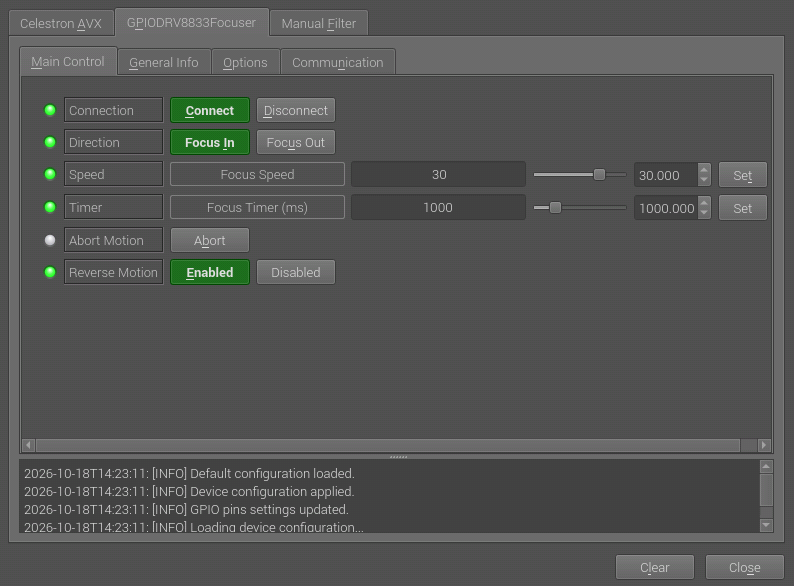

# DIY-telescope-focuser

Hardware:
- Adafruit DRV8833 DC/Stepper Motor Driver breakout board
- Mini Stepper Motor, 200 Steps, 20x30mm NEMA-8 Size
- Custom Raspberry Pi 4 hat

The custom INDI driver and focuser control software is based on:
- INDI indi-gpio_pwm_focus driver https://github.com/sywong2000/indi-gpio_pwm_focus
- Low-level GPIO library bcm2835 library https://www.airspayce.com/mikem/bcm2835/
- Arduino Stepper motor library https://github.com/arduino-libraries/Stepper
- Raspberry Pi adapted implementation of Arduino stepper motor library https://github.com/abewieland/RPI-Stepper

Custom Raspberry Pi 4 "RASAberry OmegaHAT" hat carrying the Adafruit DRV8833 motor driver:

<<<<<<< HEAD
User interface - INDI control panel:

The focuser in action:\

=======
The focuser in action:

>>>>>>> 88fc358dbc2f1f07c18399f5f549c9e17c37c252
