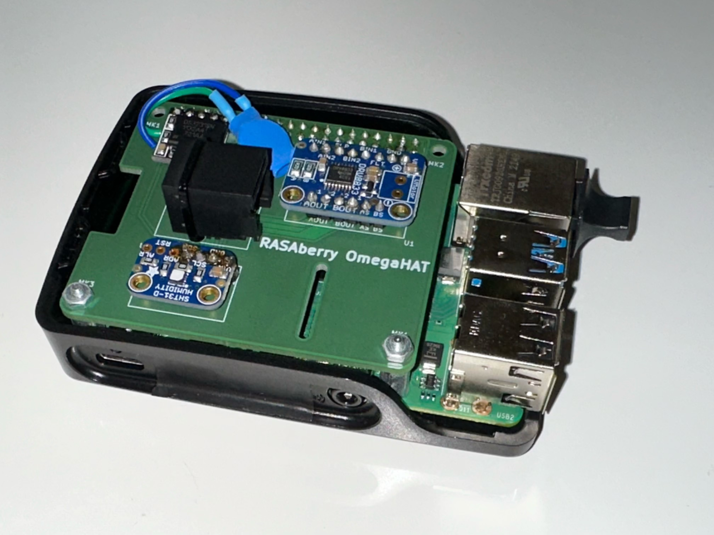
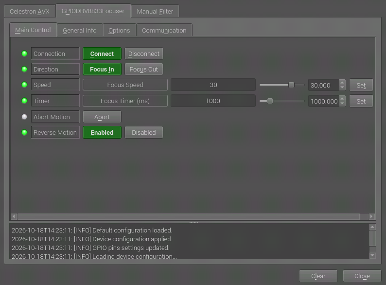
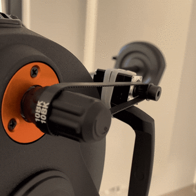
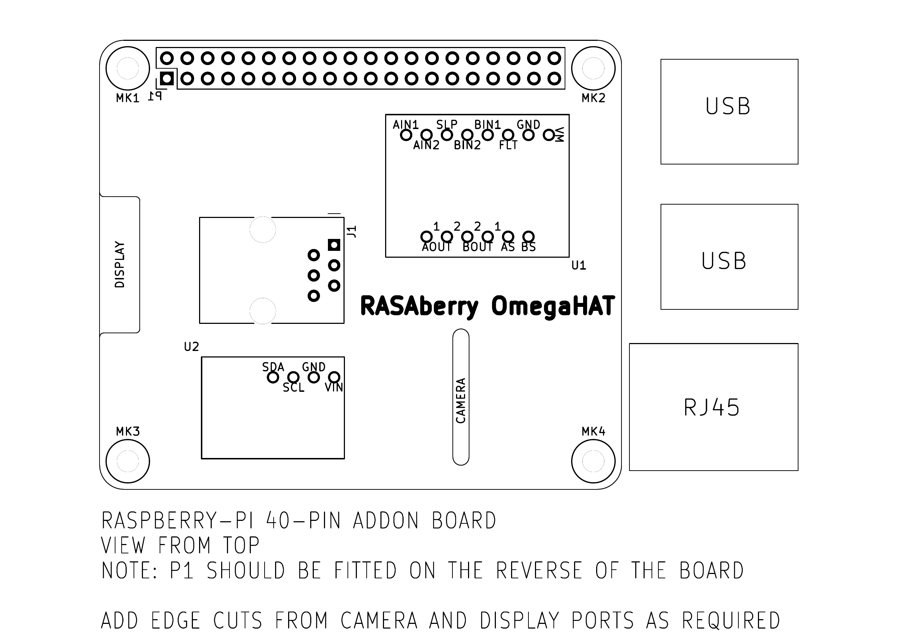

# DIY-telescope-focuser

Hardware:
- Adafruit DRV8833 DC/Stepper Motor Driver breakout board
- Mini Stepper Motor, 200 Steps, 20x30mm NEMA-8 Size
- Custom Raspberry Pi 4 hat (PCB design and production files stored under [fabrication/](https://github.com/dom128/DIY-telescope-focuser/tree/main/fabrication) )

The custom INDI driver and focuser control software is based on:
- INDI indi-gpio_pwm_focus driver https://github.com/sywong2000/indi-gpio_pwm_focus
- Low-level GPIO library bcm2835 https://www.airspayce.com/mikem/bcm2835/
- Arduino Stepper motor library https://github.com/arduino-libraries/Stepper
- Raspberry Pi adapted implementation of Arduino stepper motor library https://github.com/abewieland/RPI-Stepper

Custom Raspberry Pi 4 (Model B Rev 1.5) "RASAberry OmegaHAT" hat carrying the Adafruit DRV8833 motor driver:

User interface - INDI control panel:

The focuser in action:\

## Getting started

To build and install the `indi-gpio_drv8833_focus` driver, please follow the instructions under [INDI driver README.md](https://github.com/dom128/indi-gpio_drv8833_focus/blob/main/README.md)

## DIY hardware setup

### Shopping list

PCB assembly:
- 2x20 female GPIO pin header for Raspberry Pi
- Adafruit DRV8833 Motor Driver Breakout PCB
- RJ12 6p6c modular jack (or RJ11 6P4C) matching the PCB footprint
- (optional) Adafruit Sensirion SHT31-D Temperature & Humidity Sensor PCB

Stepper motor and cabling:
- RJ12 6p6c telephone cord
- Adafruit Mini Stepper Motor

### PCB layout

The correct pin-out and wiring is schematized in [fabrication/schematic.pdf](fabrication/schematic.pdf). Ideally, one uses an open ended (one-sided) RJ12 telephone cord to connect the hat with the stepper motor via the RJ12 jack. Make sure that the cable connects the driver pins (*AOUT1*, *AOUT2*, *BOUT1*, and *BOUT2*) to the stepper motor correctly (see stepper motor and DRV8833 documentation).

